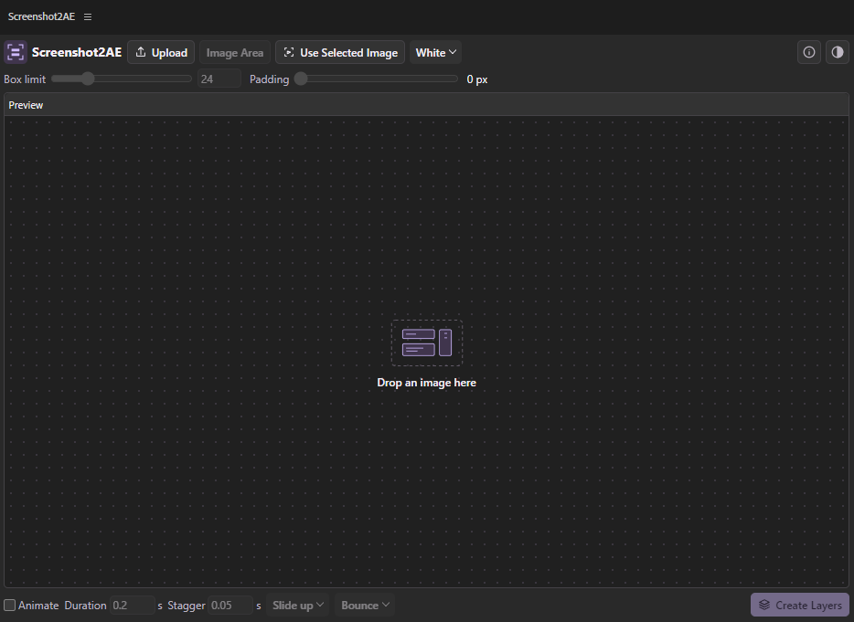
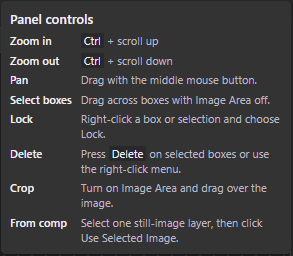
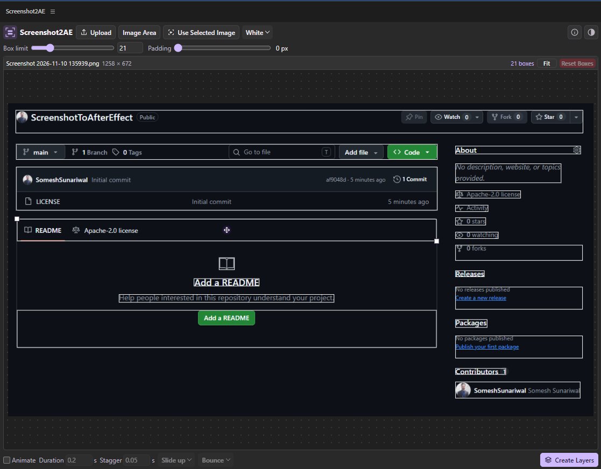

# Screenshot2AE

## Overview

Screenshot2AE is an Adobe After Effects extension that turns a screenshot or still image into separate, editable layers. It automatically draws boxes around regions of the image. You can adjust those boxes before creating a composition and optionally animate the layers in sequence.

## How to use it

1. **Load an image.** Click **Upload**, drop an image into the panel, or select one still-image layer in the active composition and click **Use Selected Image**.
2. **Navigate the preview.** Hold **Ctrl** and scroll to zoom. Drag with the middle mouse button to pan. Click **Fit** to return to the full view.
3. **Choose what to cut.** By default, the panel uses the full image. Turn on **Image Area** and drag over a section to work on it. Click **Full image** to clear the crop. Use **Box limit** to change the maximum number of boxes, **Padding** to adjust the space around each box, and the color menu to change the outlines. The slider goes up to 99, and you can enter 100 in the number field.
4. **Refine the boxes.** Hover over a box and drag its center to move it or either visible corner handle to resize it. Right-click a box to lock, unlock, or delete it. Right-click an uncovered part of the image to add a box there. With **Image Area** off, drag across several boxes to select them together. Box edits, locks, and deletions are kept when you change the box limit or padding. Click **Reset Boxes** beside **Fit** to restore automatic boxes for the current area.
5. **Create the layers.** Click **Create Layers** to generate a new composition with the cutouts ordered from top to bottom and a separate background layer. To animate the cutouts, enable **Animate** and choose the direction and effect. The defaults are **0.2 s** duration, **0.05 s** stagger, **Slide up**, and **Bounce**. Adjust the motion for all cutouts from the **Controller** layer in the generated composition.

Click the **info** icon beside the theme toggle to see the controls inside the panel. Keep the **Screenshot2AE Assets** folder in **Documents** with your project media so After Effects can find the exported layers.

## Download and install on Windows

1. On the GitHub repository page, choose **Code → Download ZIP**, then extract the archive. If you already have the extension ZIP, extract it directly. [GitHub’s download guide](https://docs.github.com/en/repositories/working-with-files/using-files/downloading-source-code-archives)
2. Close After Effects. Copy the extracted extension folder into `C:\Program Files (x86)\Common Files\Adobe\CEP\extensions\` and name it `Screenshot2AE`. Copying into this location requires administrator access. [Adobe’s CEP installation locations](https://github.com/Adobe-CEP/CEP-Resources/blob/master/CEP_12.x/Documentation/Debugging%20Handbook.md)
3. To load this unsigned extension, open Windows **Registry Editor**. Under `HKEY_CURRENT_USER\Software\Adobe\CSXS.12`, create a **String Value** named `PlayerDebugMode` and set it to `1`. If your After Effects installation uses CEP 11, use `CSXS.11` instead. This setting allows unsigned CEP extensions for your Windows account. [Adobe’s unsigned extension setup](https://github.com/Adobe-CEP/CEP-Resources/blob/master/CEP_12.x/Documentation/Debugging%20Handbook.md)
4. Reopen After Effects and choose **Window → Extensions → Screenshot2AE**.

## License Info

Check License File
